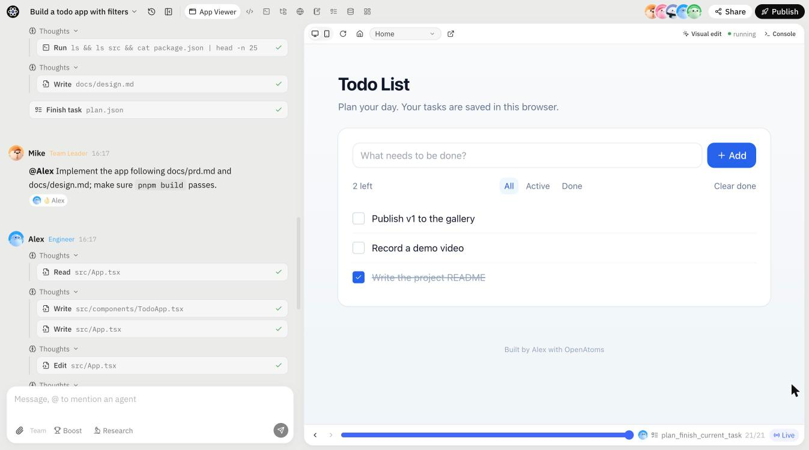
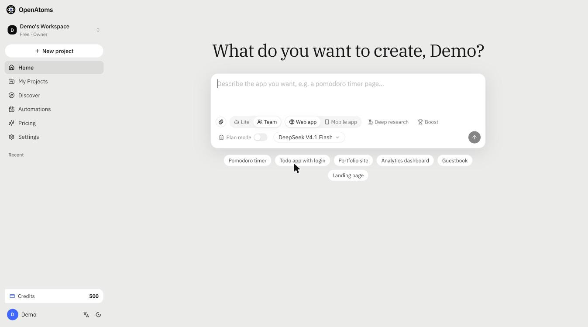
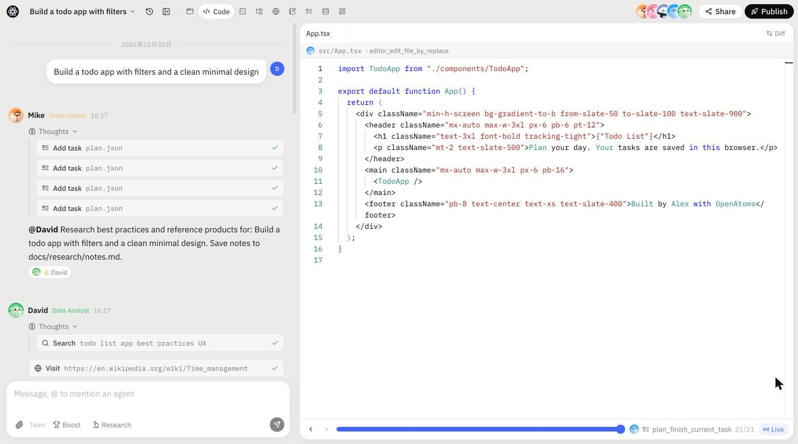
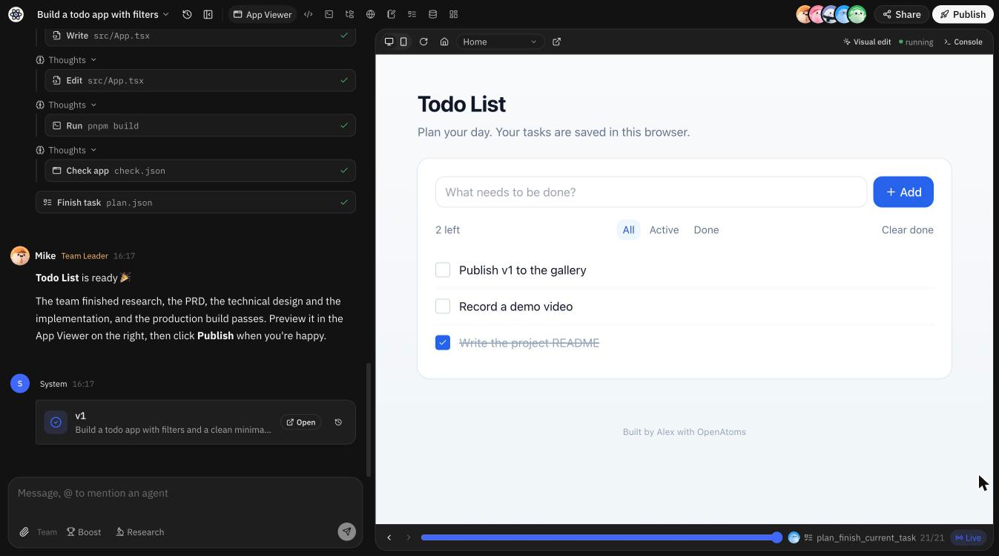

<div align="center">


# OpenAtoms

**An open-source AI team that plans, builds, previews and ships full-stack web apps from a single prompt.**

English · [简体中文](README.zh-CN.md)

[](LICENSE)




</div>

## What is OpenAtoms?

OpenAtoms is an open re-implementation of [atoms.dev](https://atoms.dev)-style multi-agent app building. You describe the
app you want; a team of agents — **Mike** (team leader), **Emma** (product manager), **Bob** (architect), **Alex**
(engineer) and **David** (data analyst) — researches it, writes a PRD and a technical design, implements it in an
isolated per-project sandbox, runs the build, and hands you a live preview you can version, share and publish.

It runs entirely on your machine in **lite mode** (SQLite, no external services, a deterministic mock model that needs
no API key), and scales up to a **full mode** backed by Postgres, Redis, S3 and Docker/Kubernetes sandboxes.

## Features

- 🤖 **Multi-agent team** — role-specialised agents with their own tools, coordinated by a team leader through a shared plan.
- 🧪 **Per-project sandboxes** — every project gets its own workspace, dev server, terminal and Python kernel (`sandboxd`).
- 👀 **Live preview & visual editing** — preview the app as it is built; click an element to change its text or classes and commit it as a new version.
- 🕓 **Versions, replay & sharing** — every turn produces a version; scrub through the agent timeline or share a read-only replay.
- 🚀 **One-click publish** — publish apps to `*.app.localhost` through the Go gateway, with an optional backend via the bundled app SDK (auth, entities, storage, AI).
- 🏆 **Boost (best-of-N)** — run several candidate builds in parallel and keep the best one.
- 🔎 **Specialists** — Iris (deep research with citations), Sarah (SEO) and Adrian (ad campaign planning).
- ⏰ **Automations** — scheduled agent runs.
- 🖼️ **Multimodal tools** — image generation/analysis, PDF/DOCX extraction, Markdown → PDF.
- 📱 **Mobile apps** — an Expo template alongside the React + shadcn/ui + Vite web template.
- 🔌 **Bring your own model** — any OpenAI-compatible endpoint (LiteLLM, OpenAI, Anthropic via proxy, DeepSeek, Moonshot…).
- 🏭 **Production-ready path** — warm sandbox pool, quotas and rate limits, Prometheus metrics, OpenTelemetry, gVisor-isolated Kubernetes sandboxes.

## Screenshots

| Start from a prompt | Watch the team work |
| :---: | :---: |
|  |  |
| **Live preview** | **Dark mode** |
|  |  |

## Quick start

**Requirements:** Node 22+ (with corepack/pnpm), Python 3.11+ with [`uv`](https://github.com/astral-sh/uv), Go 1.23+.

```bash
cp .env.example .env    # optional: set OA_LLM_BASE_URL / OA_LLM_API_KEY for real models
make install            # pnpm + uv dependencies, template dependencies
make dev                # api :8100 · gateway :8080 · web :3000
open http://localhost:3000
```

Lite mode stores everything under `data/`: SQLite at `data/oa.db`, files in `data/storage`, and each project's sandbox
(`sandboxd` + Vite dev server) runs as host processes in `data/chats/<id>/workspace`.

### Models

The default model, `oa-mock`, is a deterministic scripted model: every role makes real tool calls and Alex writes a
working React app tailored to the prompt (todo, pomodoro, counter, landing page…). It needs no API key and powers the
end-to-end tests.

To use real models, point `OA_LLM_BASE_URL` at any OpenAI-compatible endpoint and pick the model in the dashboard. A
LiteLLM proxy is included:

```bash
docker compose -f deploy/docker-compose.yml --profile llm up litellm   # put ANTHROPIC_API_KEY etc. in .env
```

### Full mode

Postgres + Redis + S3 (versitygw) + Docker sandboxes + arq worker:

```bash
make image      # builds openatoms/sandbox:latest — rebuild whenever templates/ change
make dev-full   # starts infra via docker compose, then api / worker / gateway / web
```

Full mode keeps a warm pool of pre-started sandboxes (`OA_SANDBOX_WARM_POOL`), enforces per-plan quotas and rate
limits, and exposes Prometheus metrics (`/metrics`, gateway `/__oa/metrics`). See [`docs/impl/prod.md`](docs/impl/prod.md).

## Architecture

```
            ┌──────────────────────┐        Socket.IO / REST        ┌──────────────────────────────┐
 Browser ──▶│ apps/web  (Next.js)  │ ◀────────────────────────────▶ │ services/server  (FastAPI)   │
            └──────────┬───────────┘                                │ agents · tools · arq worker  │
                       │ iframe preview                             └──────────────┬───────────────┘
            ┌──────────▼───────────┐                                               │ exec / fs / ports
            │ apps/gateway  (Go)   │ ── *.app.localhost ──▶ ┌────────────────────────▼───────────────┐
            │ preview · publish    │                        │ sandbox: services/sandboxd (Go) + app  │
            └──────────────────────┘                        └────────────────────────────────────────┘
```

| Path | Description |
| --- | --- |
| `apps/web` | Next.js workbench — dashboard, chat workbench, share replay, settings |
| `apps/gateway` | Go preview/publish gateway (`*.app.localhost:8080`), `bridge.js` injection, preview auth |
| `apps/bridge` | `bridge.js` injected into user apps (errors, console, route, visual select → parent) |
| `services/server` | Python: FastAPI REST + Socket.IO + agents + tools + sandbox manager + arq worker |
| `services/sandboxd` | Go daemon inside each sandbox: exec (SSE), fs, supervised processes, ports, Python kernel |
| `templates/` | Project templates (`react-shadcn-vite`, `expo-app`) |
| `packages/app-sdk` | SDK used by generated apps (auth / entities / storage / AI) |
| `packages/protocol` | TS protocol types generated from `services/server/oa/protocol.py` (`make protocol`) |
| `images/sandbox` | Sandbox base image (Node 22, pnpm, Python + uv, git, sandboxd) |
| `deploy/` | docker-compose, Dockerfiles, Kubernetes manifests (gVisor, NetworkPolicy), observability |
| `evals/` | Agent regression suite |

Design docs: [`docs/ARCHITECTURE.md`](docs/ARCHITECTURE.md) · [`docs/PLAN.md`](docs/PLAN.md) · binding protocol contract [`docs/CONTRACT.md`](docs/CONTRACT.md) · implementation notes in [`docs/impl/`](docs/impl/).

## Testing

```bash
make test                         # Go unit tests + Python tests
make e2e                          # boots a throwaway lite stack and runs scripts/e2e.py
./scripts/e2e.sh lite --p9        # …plus boost, specialists, media, automations, Expo
uv run evals/run.py               # agent quality suite against a running stack
```

Full-mode e2e (after `make infra-up`):

```bash
OA_MODE=full OA_STORAGE=s3 OA_SANDBOX_PROVIDER=docker OA_QUEUE=arq ./scripts/e2e.sh full --p9
```

## Deployment

`deploy/k8s` (kustomize) contains api / worker / gateway / web Deployments, per-project sandbox Pods in the
`openatoms-sandboxes` namespace with a gVisor RuntimeClass, egress NetworkPolicy, quotas, an RWX workspace PVC
(JuiceFS/EFS) and a wildcard ingress. Images are built from `deploy/docker/*.Dockerfile` and `images/sandbox/Dockerfile`.

- `scripts/k8s_kind_e2e.sh` — run the full e2e suite on a local kind cluster
- `scripts/backup.sh` / `scripts/restore.sh` — backup and restore
- `scripts/loadtest.py` — load testing
- `deploy/observability/` — metrics, tracing and dashboards

## Contributing

Contributions are welcome! Please open an issue to discuss larger changes first.

1. Fork the repository and create a feature branch.
2. Run `make test` (and `make e2e` for changes touching the agent loop or sandbox).
3. If you change `services/server/oa/protocol.py`, regenerate types with `make protocol`; keep [`docs/CONTRACT.md`](docs/CONTRACT.md) in sync.
4. Open a pull request describing the change and how you tested it.

## Acknowledgements

Inspired by [atoms.dev](https://atoms.dev) and [MetaGPT](https://github.com/FoundationAgents/MetaGPT). OpenAtoms is an
independent project and is not affiliated with or endorsed by them.

## License

[MIT](LICENSE) © OpenAtoms Contributors
