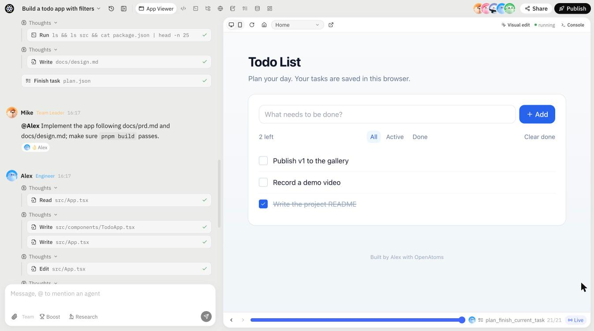
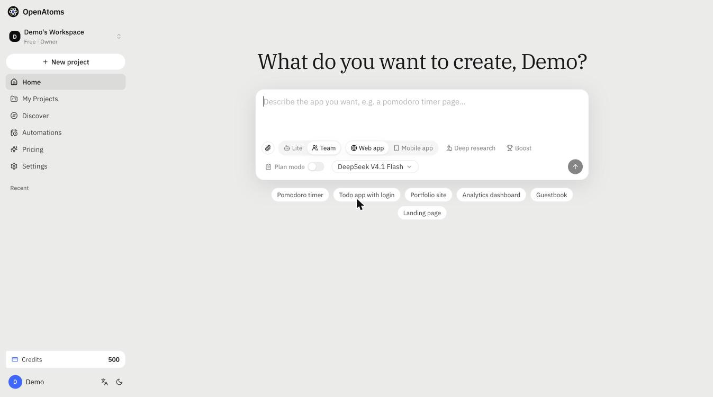
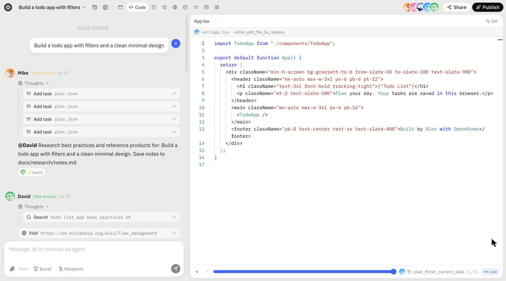
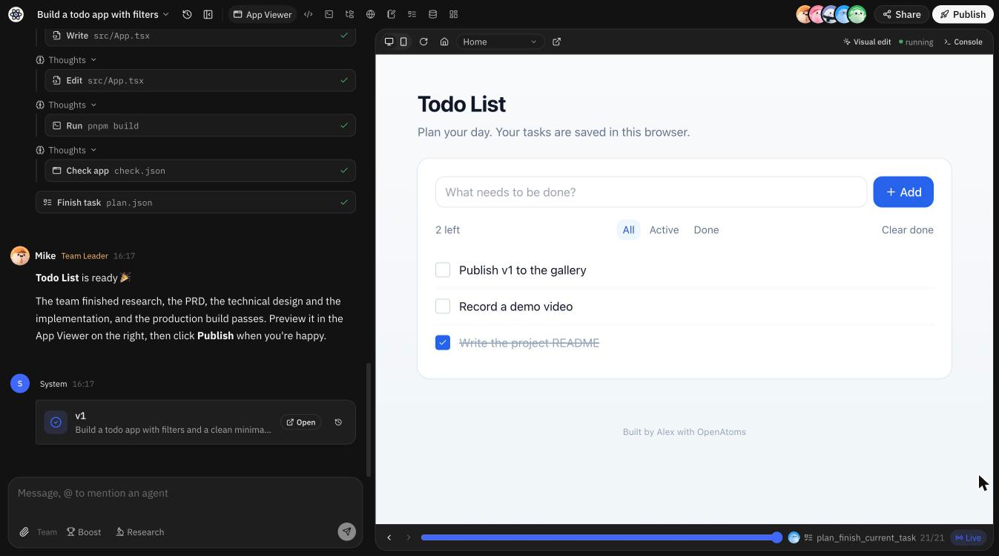

<div align="center">


# OpenAtoms

**开源的 AI 开发团队：一句话需求，自动完成规划、编码、预览与发布全栈 Web 应用。**

[English](README.md) · 简体中文

[](LICENSE)




</div>

## 简介

OpenAtoms 是对 [atoms.dev](https://atoms.dev) 式多智能体应用构建的开源实现。你只需描述想要的应用，由
**Mike**（团队负责人）、**Emma**（产品经理）、**Bob**（架构师）、**Alex**（工程师）和 **David**（数据分析师）
组成的智能体团队就会完成调研、撰写 PRD 与技术设计，在每个项目独立的沙箱中实现并构建，最终交付一个可以
版本管理、分享和发布的实时预览。

**Lite 模式**完全在本机运行（SQLite、零外部依赖、无需 API Key 的确定性 Mock 模型）；**Full 模式**则基于
Postgres、Redis、S3 以及 Docker / Kubernetes 沙箱，可用于生产部署。

## 功能特性

- 🤖 **多智能体协作** —— 各角色拥有专属工具，由团队负责人通过共享计划统一调度。
- 🧪 **项目级沙箱** —— 每个项目独享工作区、开发服务器、终端与 Python 内核（`sandboxd`）。
- 👀 **实时预览与可视化编辑** —— 边构建边预览；点击页面元素即可修改文本或样式类，并提交为新版本。
- 🕓 **版本、回放与分享** —— 每轮对话生成一个版本；可拖动时间轴回看智能体过程，或分享只读回放。
- 🚀 **一键发布** —— 通过 Go 网关发布到 `*.app.localhost`，并可借助内置 App SDK 获得后端能力（认证、数据实体、存储、AI）。
- 🏆 **Boost 竞赛模式（Best-of-N）** —— 并行生成多个候选版本，择优保留。
- 🔎 **专家角色** —— Iris（带引用的深度研究）、Sarah（SEO）、Adrian（广告投放计划）。
- ⏰ **定时任务** —— 按计划自动运行智能体。
- 🖼️ **多模态工具** —— 图像生成/理解、PDF/DOCX 解析、Markdown 转 PDF。
- 📱 **移动应用** —— 除 React + shadcn/ui + Vite Web 模板外，还提供 Expo 模板。
- 🔌 **自选模型** —— 兼容任意 OpenAI 风格接口（LiteLLM、OpenAI、经代理的 Anthropic、DeepSeek、Moonshot 等）。
- 🏭 **生产就绪** —— 沙箱预热池、配额与限流、Prometheus 指标、OpenTelemetry、基于 gVisor 隔离的 Kubernetes 沙箱。

## 截图

| 从一句话开始 | 观看团队协作 |
| :---: | :---: |
|  |  |
| **实时预览** | **深色模式** |
|  |  |

## 快速开始

**环境要求：** Node 22+（启用 corepack/pnpm）、Python 3.11+ 及 [`uv`](https://github.com/astral-sh/uv)、Go 1.23+。

```bash
cp .env.example .env    # 可选：设置 OA_LLM_BASE_URL / OA_LLM_API_KEY 以使用真实模型
make install            # 安装 pnpm + uv 依赖及模板依赖
make dev                # api :8100 · gateway :8080 · web :3000
open http://localhost:3000
```

Lite 模式的所有数据都位于 `data/` 下：SQLite 数据库 `data/oa.db`、文件存储 `data/storage`，每个项目的沙箱
（`sandboxd` + Vite 开发服务器）以宿主机进程形式运行在 `data/chats/<id>/workspace`。

### 模型

默认模型 `oa-mock` 是一个确定性的脚本化模型：每个角色都会发起真实的工具调用，Alex 会根据需求写出可运行的
React 应用（待办、番茄钟、计数器、落地页等）。它无需 API Key，也是端到端测试的基础。

如需使用真实模型，将 `OA_LLM_BASE_URL` 指向任意 OpenAI 兼容接口，并在首页选择模型即可。项目内置了
LiteLLM 代理：

```bash
docker compose -f deploy/docker-compose.yml --profile llm up litellm   # 在 .env 中配置 ANTHROPIC_API_KEY 等
```

### Full 模式

Postgres + Redis + S3（versitygw）+ Docker 沙箱 + arq worker：

```bash
make image      # 构建 openatoms/sandbox:latest —— 修改 templates/ 后需重新构建
make dev-full   # 通过 docker compose 启动基础设施，再启动 api / worker / gateway / web
```

Full 模式会维护预启动的沙箱池（`OA_SANDBOX_WARM_POOL`），按套餐执行配额与限流，并暴露 Prometheus 指标
（`/metrics`、网关 `/__oa/metrics`）。详见 [`docs/impl/prod.md`](docs/impl/prod.md)。

## 架构

```
            ┌──────────────────────┐        Socket.IO / REST        ┌──────────────────────────────┐
 浏览器 ──▶ │ apps/web  (Next.js)  │ ◀────────────────────────────▶ │ services/server  (FastAPI)   │
            └──────────┬───────────┘                                │ agents · tools · arq worker  │
                       │ iframe 预览                                └──────────────┬───────────────┘
            ┌──────────▼───────────┐                                               │ exec / fs / ports
            │ apps/gateway  (Go)   │ ── *.app.localhost ──▶ ┌────────────────────────▼───────────────┐
            │ 预览 · 发布           │                        │ 沙箱：services/sandboxd (Go) + 应用    │
            └──────────────────────┘                        └────────────────────────────────────────┘
```

| 路径 | 说明 |
| --- | --- |
| `apps/web` | Next.js 工作台 —— 首页、对话工作台、分享回放、设置等 |
| `apps/gateway` | Go 预览/发布网关（`*.app.localhost:8080`），负责注入 `bridge.js` 与预览鉴权 |
| `apps/bridge` | 注入用户应用的 `bridge.js`（错误、控制台、路由、可视化选取 → 父页面） |
| `services/server` | Python：FastAPI REST + Socket.IO + 智能体 + 工具 + 沙箱管理 + arq worker |
| `services/sandboxd` | 运行在沙箱内的 Go 守护进程：执行（SSE）、文件系统、进程托管、端口、Python 内核 |
| `templates/` | 项目模板（`react-shadcn-vite`、`expo-app`） |
| `packages/app-sdk` | 生成应用使用的 SDK（认证 / 数据实体 / 存储 / AI） |
| `packages/protocol` | 由 `services/server/oa/protocol.py` 生成的 TS 协议类型（`make protocol`） |
| `images/sandbox` | 沙箱基础镜像（Node 22、pnpm、Python + uv、git、sandboxd） |
| `deploy/` | docker-compose、Dockerfile、Kubernetes 清单（gVisor、NetworkPolicy）、可观测性 |
| `evals/` | 智能体回归测试集 |

设计文档：[`docs/ARCHITECTURE.md`](docs/ARCHITECTURE.md) · [`docs/PLAN.md`](docs/PLAN.md) · 协议契约 [`docs/CONTRACT.md`](docs/CONTRACT.md) · 实现说明见 [`docs/impl/`](docs/impl/)。

## 测试

```bash
make test                         # Go 单元测试 + Python 测试
make e2e                          # 启动临时 lite 环境并运行 scripts/e2e.py
./scripts/e2e.sh lite --p9        # 额外覆盖 Boost、专家角色、多媒体、定时任务、Expo
uv run evals/run.py               # 针对运行中的服务执行智能体质量评测
```

Full 模式端到端测试（需先 `make infra-up`）：

```bash
OA_MODE=full OA_STORAGE=s3 OA_SANDBOX_PROVIDER=docker OA_QUEUE=arq ./scripts/e2e.sh full --p9
```

## 部署

`deploy/k8s`（kustomize）包含 api / worker / gateway / web 的 Deployment，以及位于 `openatoms-sandboxes`
命名空间、使用 gVisor RuntimeClass 的项目级沙箱 Pod，外加出口 NetworkPolicy、资源配额、RWX 工作区 PVC
（JuiceFS/EFS）和泛域名 Ingress。镜像由 `deploy/docker/*.Dockerfile` 与 `images/sandbox/Dockerfile` 构建。

- `scripts/k8s_kind_e2e.sh` —— 在本地 kind 集群上运行完整端到端测试
- `scripts/backup.sh` / `scripts/restore.sh` —— 备份与恢复
- `scripts/loadtest.py` —— 压力测试
- `deploy/observability/` —— 指标、链路追踪与仪表盘

## 参与贡献

欢迎贡献！较大的改动请先开 Issue 讨论。

1. Fork 本仓库并创建功能分支。
2. 运行 `make test`（涉及智能体循环或沙箱的改动请同时运行 `make e2e`）。
3. 若修改了 `services/server/oa/protocol.py`，请执行 `make protocol` 重新生成类型，并同步更新 [`docs/CONTRACT.md`](docs/CONTRACT.md)。
4. 提交 Pull Request，说明改动内容及测试方式。

## 致谢

本项目受 [atoms.dev](https://atoms.dev) 与 [MetaGPT](https://github.com/FoundationAgents/MetaGPT) 启发。
OpenAtoms 为独立项目，与上述项目无任何隶属或背书关系。

## 许可证

[MIT](LICENSE) © OpenAtoms Contributors
