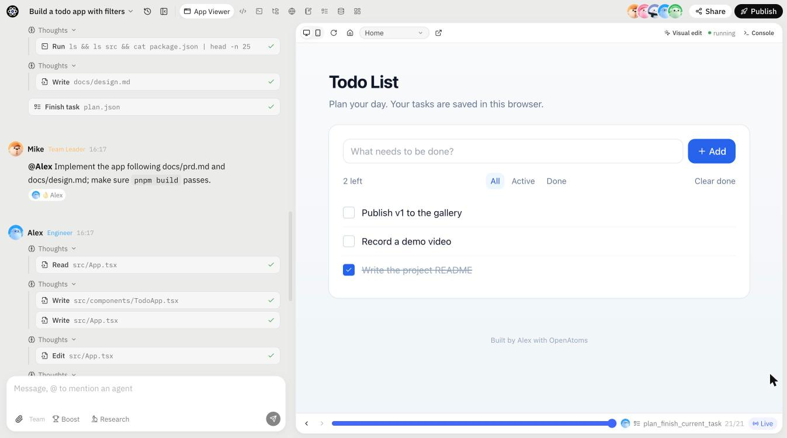

# OpenAtoms 项目实践报告

> 题目：复刻 [atoms.dev](https://atoms.dev)（原 MGX / MetaGPT X）多智能体全栈应用搭建平台。
> 本文说明实现思路与关键取舍、当前完成程度，以及继续投入时的扩展计划与优先级。
> 相关文档：逆向资料 [`re/REPORT.md`](../re/REPORT.md)、[`re/SERVER.md`](../re/SERVER.md)；设计 [`ARCHITECTURE.md`](ARCHITECTURE.md)；分阶段计划 [`PLAN.md`](PLAN.md)；接口契约 [`CONTRACT.md`](CONTRACT.md)；实现与实测记录 [`impl/`](impl/)。

---

## 1. 一句话概述

用户输入一句需求，由 Mike（团队负责人）、Emma（产品经理）、Bob（架构师）、Alex（工程师）、David（数据分析师）组成的智能体团队完成规划、PRD、技术设计和编码，代码在每个项目独立的沙箱中构建运行，右侧实时预览，每轮生成可回滚的版本，并可一键发布到独立子域名。



---

## 2. 实现思路

### 2.1 方法：先逆向，再定契约，最后分阶段实现

复刻一个闭源产品，最大的风险是"凭印象做出一个长得像但交互逻辑不同的东西"。所以我按下面的顺序推进：

1. **逆向分析（`re/`）**。下载并分析 Atoms 已发布的 599 个前端 chunk，在已登录的浏览器会话里观测路由表、Pinia store、XHR 与 Socket.IO 报文、部署出来的应用页面。产出：
   - 前端与协议报告：193 条路由、统一响应结构 `{code, message, data, now_ts}`、Socket 事件名（`msg:create`、`timeline:*`、`version:*` 等）、`block_type` / `command_name` 枚举、设计 token；
   - 服务端推断：每个项目一个容器、工作区路径、预览和发布域名规则、BaaS 接口形态。

   每条结论都标注了证据等级：**观测 / 静态 / 推断**。
2. **架构设计（`ARCHITECTURE.md`）**。每一项都标明是〔对齐〕Atoms、〔补齐〕Atoms 不可见的部分，还是〔取舍〕有意不同。
3. **接口契约（`CONTRACT.md`）**。把 REST、Socket 事件、block 内容格式、sandboxd API、网关规则写成实现必须遵守的契约。前后端、Go 服务据此并行开发；实现中的每一处偏离都回写到 §11。
4. **分阶段实现（`PLAN.md`，P0–P9）**。先打通纵向主干"输入 → Agent → 沙箱 → 预览"，再横向扩展角色和功能。每个阶段结束都要能端到端演示。

### 2.2 总体架构

```
            ┌──────────────────────┐        Socket.IO / REST        ┌──────────────────────────────┐
 浏览器 ──▶ │ apps/web  (Next.js)  │ ◀────────────────────────────▶ │ services/server  (FastAPI)   │
            └──────────┬───────────┘                                │ 编排器 · 角色 · 工具 · worker │
                       │ iframe 预览                                └──────────────┬───────────────┘
            ┌──────────▼───────────┐                                               │ exec / fs / ports
            │ apps/gateway  (Go)   │ ── *.app.localhost ──▶ ┌────────────────────────▼───────────────┐
            │ 预览鉴权 · 发布 · 注入 │                        │ 沙箱：services/sandboxd (Go) + 用户应用 │
            └──────────────────────┘                        └────────────────────────────────────────┘
```

| 组件 | 技术 | 职责 |
|---|---|---|
| `apps/web` | Next.js 15 + React 19 + Tailwind + Zustand | 首页、工作台（对话 + 预览/代码/终端/文件/后端面板）、分享回放、设置、定价、发现页 |
| `services/server` | Python 3.12 + FastAPI + python-socketio + SQLAlchemy + arq | REST、实时推送、多智能体运行时、工具、沙箱管理、计费、集成 |
| `services/sandboxd` | Go 单二进制 | 运行在沙箱内：命令执行（SSE 流）、文件系统、进程托管、端口探测、Python kernel |
| `apps/gateway` | Go `httputil.ReverseProxy` | 预览/发布域名路由、私有预览 ticket 鉴权、向 HTML 注入 `bridge.js`、沙箱唤醒页 |
| `apps/bridge` | TypeScript → 单文件 IIFE | 注入用户应用：错误/console/路由上报，可视化编辑选区 |
| `packages/app-sdk` | TypeScript | 生成的应用使用的 SDK：认证、数据实体、存储、AI |
| `templates/` | React + shadcn/ui + Vite；Expo | 生成应用的项目模板 |

### 2.3 核心链路

```
用户消息 ─▶ 审核 / 配额 / 余额预检 ─▶ chat 锁（已有运行则进 prompt 队列）
        ─▶ 确保沙箱运行（预热池认领或冷启动）
        ─▶ Orchestrator 状态机
             lite: Alex 实现 ─▶ 构建与 UI 自检 ─▶ 结束
             full: Mike 规划 ─▶ [计划审批 ⏸] ─▶ 逐个任务派发给角色 ─▶ Alex 任务构建自检 ─▶ Mike 汇总
             每个角色内部：LLM tool-calling 循环 ─▶ 工具 ─▶ sandboxd
        ─▶ 每一步落库：message + action_data + block_timeline，同时推送带 seq 的 Socket 事件
        ─▶ 回合结束：git commit + tag vN ─▶ pnpm build ─▶ Playwright 截封面 ─▶ version:complete
```

几个关键机制：

- **事件溯源式渲染**：实时推送和历史回放共用一套数据（消息、工具调用、时间线块）。分享页的"回放"只是按时间线重放。
- **可恢复运行**：Run 的状态（当前阶段、任务游标、挂起点）持久化。`ask_human`、计划审批、构建失败后的"是否继续修复"都通过挂起实现，用户回复后从断点继续；worker 崩溃后也可以从断点恢复。
- **自检与修复**：Alex 写完代码后自动运行 `pnpm build`，并用 Playwright 加载预览页收集页面错误、console 错误和失败请求（`checkui_run`），失败最多自动修复 3 轮，之后向用户发审批卡。
- **可靠推送**：每个事件按 chat 带单调递增的 `seq`。客户端发现缺口时调 `/events?after=` 补齐；补齐过程中到达的实时事件先缓冲，再按序应用。

---

## 3. 关键取舍

| # | 决策 | 理由 | 代价 / 风险 |
|---|---|---|---|
| 1 | **协议命名对齐 Atoms**（事件名、`block_type`、`command_name`、响应结构、域名规则） | 交互逻辑有现成参照，前端渲染逻辑可以直接对照逆向结果实现，减少设计决策 | 部分命名不够直观，需要在 CONTRACT 里解释 |
| 2 | **前端用 Next.js/React，不用 Atoms 的 Nuxt/Vue** | 与生成应用的技术栈（React + shadcn）一致，生态更大 | 无法直接参考 Atoms 的组件实现，只能复刻视觉和交互 |
| 3 | **编排器做成确定性状态机，角色内部才交给 LLM**。没有让 Team Leader 的 LLM 完全自由地调度 | 阶段明确，可以持久化和断点恢复，也便于测试；成本可控，不会出现 TL 无限循环派发 | 灵活性低于 Atoms：任务拆分由 Mike 生成，但执行顺序固定，不支持角色之间任意对话 |
| 4 | **Lite / Full 双模式**。Lite：SQLite + 本机进程沙箱 + 进程内队列，零外部依赖；Full：Postgres + Redis + S3 + Docker/K8s 沙箱 + arq worker | 评审者 `make dev` 一条命令就能跑起来；生产路径也是真的，而不是只写了设计 | 两套实现都要测试，存储、队列、沙箱都需要做 provider 抽象 |
| 5 | **内置确定性 Mock 模型 `oa-mock`**。每个角色按剧本发起真实的工具调用，Alex 会根据需求写出可运行的 React 应用 | 没有模型 API Key 也能完整演示；e2e 和压测稳定、可重复、零成本 | Mock 只能证明流程跑通，不能代表生成质量，所以另外用 DeepSeek 跑了真实评测（见 §4.1），但样本量还小 |
| 6 | **自研 sandboxd（Go）+ SandboxProvider 抽象**（local / docker / k8s），没有直接用 E2B | 存算分离：工作区在持久卷上，容器可以随时销毁重建，与 Atoms 观测到的架构一致；可以完全自托管 | 工作量明显更大：进程托管、端口探测、鉴权、预热池都要自己做 |
| 7 | **用 git 管理版本**（每轮 commit + tag） | diff、回滚、分支都是现成的；GitHub 推送也自然 | 需要注意凭据不能进入 git 历史（测试中发现过 token 泄漏到 reflog，已修复） |
| 8 | **Boost（Best-of-N）用隐藏子 chat 实现**：每个候选是一个普通项目，跑普通的一轮 | runner、工具、预览都无需特殊处理；与 Atoms 的 `bon.parent_chat_id` 设计一致 | 每个候选占一个沙箱，受套餐并发数限制 |
| 9 | **Playwright 跑在 api/worker 进程，不放进沙箱** | 沙箱镜像少约 400 MB，冷启动更快 | 浏览器访问预览要经过网关，多一跳 |
| 10 | **发布先只做静态产物**（`dist/` 上传到对象存储，网关按版本提供） | 发布即切换指针，零构建、秒级生效；后端能力由平台自带的 Cloud BaaS 和 app-sdk 提供 | 用户无法部署自定义后端代码（见 §4.2） |
| 11 | **安全上有意比 Atoms 更严**：短期 access token + refresh cookie；终端回放和分享中 secret 打码；沙箱 gVisor + 非 root + 出网策略 | 逆向时发现 Atoms 的回放里能看到明文 `.env`，长期 JWT 直接放请求头 | 实现复杂度增加 |
| 12 | **对象存储用 versitygw**，放弃 MinIO / SeaweedFS | MinIO 官方镜像已无法拉取；SeaweedFS 单节点在压测下丢失 leader，PutObject 全部 502 | 不是主流选择，生产环境建议直接用 S3/R2 |

---

## 4. 当前完成程度

### 4.1 已完成

PLAN 中的 P0–P9 全部实现并经过实测。代码规模（不含测试和生成代码）：Python 约 1.6 万行，前端约 1 万行，Go 约 2300 行（网关 + sandboxd），bridge 与 app-sdk 约 700 行。

| 阶段 | 内容 | 状态 |
|---|---|---|
| P0 地基 | monorepo（pnpm + uv + Go）、docker-compose、FastAPI + Socket.IO、Pydantic → TS 协议类型生成、CI | ✅ |
| P1 账号与项目 | 注册/登录/邮箱验证/找回密码、个人工作区、项目增删改、首页输入框创建项目 | ✅ |
| P2 单 Agent 打通 | 沙箱 + sandboxd、LLM 客户端（OpenAI 兼容，流式 + tool calls + 重试）、editor/terminal 工具、对话流式渲染、停止 | ✅ |
| P3 工作区与预览 | Go 网关 + bridge 注入、dev server 托管与唤醒、AppViewer（设备切换/路由/控制台）、代码面板（Monaco）、终端回放（xterm）、文件树与 zip 下载、时间线回放、心跳与空闲休眠 | ✅ |
| P4 版本与发布 | 每轮 git 版本 + 摘要 + 封面截图、版本历史与恢复、静态发布（固定版本或跟随 latest）、访问权限、私有预览 ticket | ✅ |
| P5 多智能体团队 | Mike 规划与派发、Emma 写 PRD、Bob 写设计、Alex 实现与构建自修复、David 用 Notebook + 浏览器调研；`ask_human` 审批卡、澄清问题表单、计划模式；prompt 队列；编辑/重试生成分支（round/attempt） | ✅ |
| P6 集成与应用后端 | Secrets（加密 + 打码）、GitHub（OAuth、建仓、push/pull）、Supabase（OAuth、关联项目、注入 .env）、平台 Cloud BaaS（每个应用独立 schema、dev/prod 分库；实体 CRUD、认证、存储、AI 文本流）+ app-sdk + 后端数据面板 | ✅ |
| P7 商业化与协作 | 积分账本、按 token 计费、Stripe 订阅与充值（webhook 幂等）、工作区成员与邀请、分享回放、Remix、发现页、Google 登录 | ✅ |
| P8 生产化 | K8s Provider（每 chat 一个 Pod + gVisor + NetworkPolicy）、沙箱预热池、配额与限流、内容审核、滥用检测、Prometheus/OTel/Sentry、Grafana 面板与告警、备份恢复、压测 | ✅ |
| P9 进阶 | Boost 竞赛模式、可视化编辑（点击元素改文本/样式并提交为版本）、Iris 深度研究 / Sarah SEO / Adrian 广告、定时任务、多模态工具（图片生成与理解、PDF/DOCX 解析、Markdown 转 PDF）、Expo 移动端模板 | ✅ |
| UI | 参照 atoms.dev 视觉语言重做首页、项目列表、发现页等，支持深色模式、中英文 | ✅ |

**验证方式**（详见 [`impl/verify.md`](impl/verify.md)、[`impl/prod.md`](impl/prod.md)）：

- **自动化测试**：Python 19 个测试文件、112 个测试函数；Go 网关与 sandboxd 单元测试；app-sdk 测试；web 构建。
- **端到端**：`scripts/e2e.sh lite --p9` 与 full 模式 e2e 均通过；K8s 在 kind 集群上跑通（包括 gVisor）；在 Chrome 中手动点击走查过 P9 的界面。
- **评测集**：`evals/cases.yaml` 有 20 个典型需求（番茄钟、看板、带登录的待办、留言板 + 云数据库等），从构建、UI 自检、内容断言三方面判定。
- **真实大模型评测（DeepSeek）**：用 `deepseek-flash` 经 OpenAI 兼容接口跑了评测集中的 5 个用例，覆盖 Lite 单 Agent 和团队模式，最终全部通过（构建成功、UI 自检无错误、内容断言命中）：

  | 用例 | 模式 | LLM 调用 | 输入 / 输出 token | 耗时 |
  |---|---|---|---|---|
  | 番茄钟 pomodoro | lite | 40 | 99.2 万 / 3.2 万 | 178 s |
  | 计数器 counter | lite | 8 | 5.3 万 / 0.3 万 | 26 s |
  | 咖啡店落地页 landing | lite | 40 | 74.7 万 / 2.8 万 | 184 s |
  | 带登录的待办 team-todo | full（5 个角色） | 66 | 149.6 万 / 8.2 万 | 479 s |
  | 留言板 + 云数据库 guestbook-cloud | full | 59 | 92.7 万 / 3.5 万 | 221 s |

  前几次运行中有 3 次失败：counter 的内容断言未命中；landing 和 guestbook-cloud 各有一次在约 4 秒内就失败，是运行环境问题，不是模型问题。修正后重跑全部通过。全过程共 225 次模型调用，约 430 万输入 token、18 万输出 token。可以看出**输入 token 远多于输出**：每一步都会重发完整上下文，这也是 §5 里把 prompt caching 和上下文压缩排得靠前的原因。
- **LLM 客户端健壮性**：另外用一个严格校验请求格式的 OpenAI 兼容伪服务端（每 7 次注入一次 503），以及经 LiteLLM 代理的方式，full 模式 e2e 均通过，0 次请求被拒；校验了所有工具 schema 都符合供应商要求。
- **压测**（本机 10 核 / 16 GB）：

  | 模式 | 并发 run | 成功 | p95 |
  |---|---|---|---|
  | lite | 40 | 40/40 | 127 s |
  | full，全局准入上限 10，预热池 2 | 20 | 20/20 | 134 s |

  压测中发现并修复了 7 个真实问题，例如：线程池被回收子进程占满导致全部卡死、DB 连接池嵌套取连接导致死锁、Docker 沙箱休眠后唤醒 401、20 个沙箱撑爆 Docker VM 内存。每个修复都补了回归测试。
- **预热池效果**：K8s 上唤醒已有项目从 1.19 s 降到 0.06 s（约 19 倍）；Docker 上新项目首次打开从约 3 s 降到约 0.5 s。

### 4.2 没做或只做了一部分

| 项 | 现状 | 原因 |
|---|---|---|
| **全栈容器发布**（BuildKit 构建镜像 → Knative，可缩容到 0） | 未做。只支持静态发布；后端能力走平台 Cloud BaaS | 核心链路优先；BaaS 已覆盖大部分"带数据"的应用场景 |
| **自定义域名**（DNS 校验 + on-demand TLS） | 未做，只有平台子域名 | 需要真实域名和证书环境才有意义 |
| **MCP 连接器** | 未做 | 优先级低于核心生成链路 |
| **交互式终端（PTY）** | 未做。终端面板只回放 Agent 执行的命令 | 用户主要通过对话驱动，手动终端是增强功能 |
| **上下文工程** | 只做了截断：保留最近若干次工具结果，旧结果截断，已应用的大参数折叠。未做 LLM 摘要压缩和 prompt caching | 先保证功能闭环。DeepSeek 实测显示输入 token 是输出的约 23 倍，这是下一步最明确的优化点 |
| **Atoms 的其他产品线**（游戏、视频、幻灯片、pSEO 营销页、21 种语言） | 未做，只做中英文 | 与"多智能体应用构建"这一核心无关 |
| **工程债** | 请求处理中嵌套开 DB session（目前靠加大连接池规避）；内容审核默认是关键词规则；server 镜像未实际构建；Docker + runsc 未实测 | 详见 `impl/prod.md` §8 |

### 4.3 需要特别说明的验证缺口

- **真实模型的评测样本还小**。DeepSeek 只跑了 20 个评测用例中的 5 个，每个用例只有 1–2 次运行，只用了一个模型。说明这条链路在真实模型下能跑通，但还谈不上稳定的成功率数据，也没有和 Claude 等其他模型做对比。自动化测试、e2e 和压测仍由 `oa-mock` 驱动。
- **第三方集成大部分已在真实环境验证**：
  - **已用真实账号验证**：
    - Google 登录；
    - GitHub：OAuth 连接、建仓、推送代码；
    - Supabase：OAuth 连接、关联项目。
  - **仍只对接过本地模拟服务**：Stripe（支付和 webhook）和 SMTP 发信。完整流程用本地模拟服务和 mailpit 跑通过，上线前需要真实的 Stripe 测试密钥和发信域名。
- **gVisor 只在 kind（Docker Desktop 内核）上实测过**，还没有在真实生产集群上验证性能。

---

## 5. 继续投入时的扩展计划与优先级

**排序原则**：这类产品的核心价值是"一句话能不能生成一个能用、好看的应用"。所以先把生成质量做实、做成可度量，再降成本，再扩大能力边界，最后才是周边功能。目前平台的"管道"已经比较完整，瓶颈在 Agent 本身。

### P0 用真实模型建立质量闭环（约 1–2 周）

1. 在已有的 DeepSeek 5 个用例基础上，用全部 20 个用例、每个跑多次，并加入 Claude 等模型，跑出可对比的基线：构建成功率、UI 自检通过率、需求覆盖率、单轮耗时、单轮 token 与成本。
2. 扩充评测集：加入多页面、带数据持久化、需要修 bug 的多轮对话等用例；引入 LLM 评审对截图打分。
3. 针对失败样本迭代提示词、工具描述和模板约束，每次改动都跑评测，避免回退。
4. 评测接入 CI，每晚运行，结果做成趋势看板。

**原因**：没有这一步，后面所有优化都无法衡量。目前只证明了真实模型能跑通，还不知道稳定性如何。

### P1 上下文工程与成本控制（约 1 周）

- Prompt caching：系统提示 + 工具定义 + 项目上下文作为缓存前缀。
- 长历史用便宜模型做摘要压缩；项目级记忆文件（Atoms 的 `.atoms/memory.md`）。
- 按角色选模型：规划和摘要用便宜模型，编码用强模型；每轮设预算上限。
- 编排上适度放开：允许 Mike 根据中间结果追加或调整任务，而不只是一次性拆分。

**原因**：DeepSeek 实测中，一个团队模式用例就消耗约 150 万输入 token，几乎都是重复发送的上下文。prompt caching 和压缩的收益最直接。

### P1 全栈应用能力（约 2 周）

- 全栈容器发布：模板带 Dockerfile，worker 用 rootless BuildKit 构建，部署为可缩容到 0 的服务。
- Cloud BaaS 目前是文档式实体表（每个应用独立 schema，dev/prod 分库），下一步支持关系型建模、索引和 Agent 驱动的数据库迁移。

**原因**：这决定了能生成的应用的上限。目前只能做前端 + 通用实体存储，复杂业务逻辑做不了。

### P2 体验与生态（约 2 周）

- 交互式终端（PTY）、用户手动编辑代码后与 Agent 协同。
- MCP 连接器：用户添加 MCP server，作为 Agent 的工具。
- 自定义域名 + 自动证书。
- 可视化编辑扩展到布局和组件层面。

### P2 生产加固（与上面并行，约 1 周）

- 修复嵌套 DB session 的根因；内容审核接入审核模型。
- 在真实集群（如 GKE Sandbox）上验证 gVisor 的性能与兼容性，以及沙箱冷启动 P95。
- 真实环境下的 Stripe 和邮件联调（Google、GitHub、Supabase 已验证）。

### P3 周边产品线

幻灯片、视频、游戏、更多语言、SEO 营销页等。这些与核心能力关系不大，按业务需要再做。

---

## 6. 本地运行

```bash
cp .env.example .env    # 可选：配置 OA_LLM_BASE_URL / OA_LLM_API_KEY 使用真实模型
make install
make dev                # api :8100 · gateway :8080 · web :3000
open http://localhost:3000
```

默认使用 `oa-mock` 模型，不需要任何 API Key。可以试试"做一个番茄钟页面"（Lite 模式）或"做一个带登录的待办应用"（团队模式）。测试：`make test`、`make e2e`、`./scripts/e2e.sh lite --p9`。
